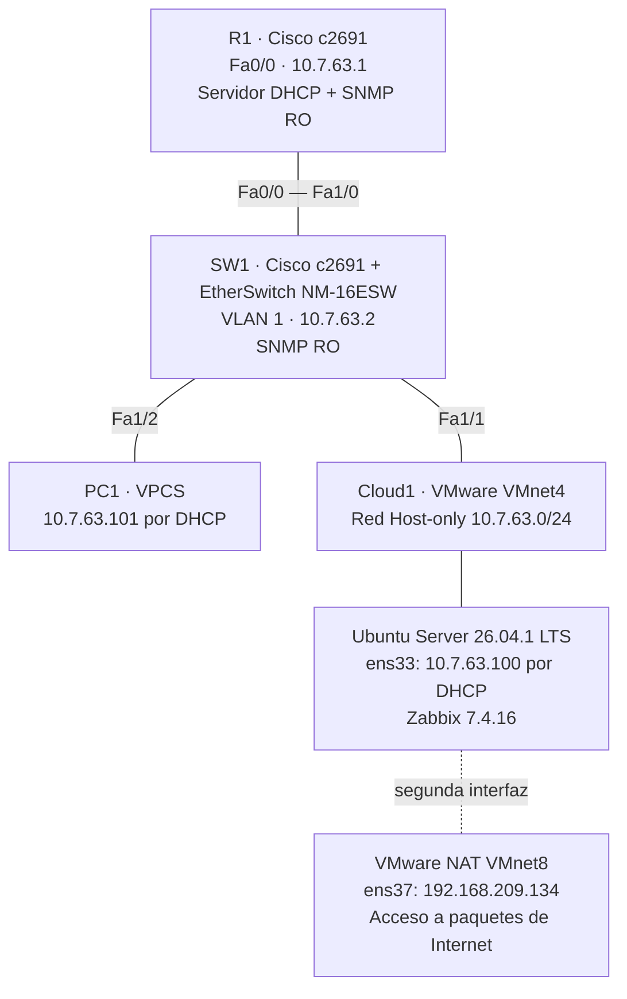

# Semana 7 · Asignación 3 — Monitoreo de redes con Zabbix, DHCP y SNMP

**Seguridad de Redes | Laboratorio individual | GNS3 + Cisco IOS + Ubuntu Server + Zabbix**

## Propósito del laboratorio

Desplegar una red LAN de pruebas con direccionamiento basado en la matrícula **20250763**, asignación automática de direcciones por **DHCP en R1** y monitoreo centralizado de **R1 y SW1** con **SNMPv2c de solo lectura**, mediante un servidor **Zabbix instalado en Ubuntu Server**. La validación se realiza mediante consultas SNMP desde Linux y métricas capturadas en la interfaz web de Zabbix.

## Topología

[Diagrama editable](diagramas/topologia.mmd) · [Diagrama SVG](diagramas/topologia.svg) · [Captura original GNS3](evidencias/05_Topologia_GNS3.png)

> Nota de identificación: el nodo Cisco utilizado como EtherSwitch puede aparecer con el nombre **R2** en la ventana GNS3; su **hostname IOS es SW1**. Es el equipo de conmutación de esta infraestructura.

## Parámetros y resultados

| Equipo | Dirección | Función | Evidencia |
| --- | --- | --- | --- |
| Router R1 | `10.7.63.1/24` | Servidor DHCP, SNMP solo lectura | [DHCP](evidencias/01_R1_DHCP_binding.png) |
| SW1 | `10.7.63.2/24` | EtherSwitch, SNMP solo lectura | [Hosts Zabbix](evidencias/04_Zabbix_hosts_SNMP.png) |
| Ubuntu Zabbix, `ens33` | `10.7.63.100/24` | Cliente DHCP desde R1; monitor SNMP | [Interfaces](evidencias/02_Ubuntu_cliente_DHCP.png) |
| PC1 | `10.7.63.101/24` | Cliente DHCP VPCS | [Concesiones R1](evidencias/01_R1_DHCP_binding.png) |
| Ubuntu, `ens37` | `192.168.209.134/24` | NAT VMware para instalación de paquetes | [Rutas](evidencias/03_Ubuntu_rutas.png) |

**Red LAN:** `10.7.63.0/24`. **Puerta de enlace de la LAN:** `10.7.63.1`.  
**Servicio SNMP:** versión 2c, UDP 161, comunidad configurada como **RO**, acceso limitado mediante ACL 15 a `10.7.63.0/24`.  
**Servidor Zabbix:** Zabbix 7.4.16, MariaDB y Apache2 sobre Ubuntu Server; panel consultado en la LAN.

## Pruebas realizadas

1. **DHCP:** `show ip dhcp binding` en R1 registra concesiones `10.7.63.100` y `10.7.63.101`; Ubuntu y VPCS obtuvieron IP automáticamente.
2. **Conectividad:** Ubuntu y PC1 alcanzaron las IP de R1 y SW1 en pruebas ICMP.
3. **SNMP en Linux:** las consultas `snmpwalk` mostraron `sysDescr`, `sysUpTime`, `sysName` y `sysLocation` de ambos equipos.
4. **Zabbix:** los hosts **Router R1** y **Switch SW1** aparecen habilitados con disponibilidad **SNMP** verde, usando plantilla `Cisco IOS by SNMP`.
5. **Datos reales:** Zabbix mostró utilización de CPU, memoria, interfaces y disponibilidad ICMP de ambos equipos. En una captura se observaron **233 elementos**, **231 normales** y **2 no soportados**; la plataforma sigue recopilando datos.

**[Informe técnico](docs/informe-tecnico.md)** · **[Evidencias integradas](docs/evidencias.md)** · **[Procedimiento y comandos](docs/procedimiento.md)**

## Estructura del repositorio

| Ruta | Contenido |
| --- | --- |
| `configuraciones/R1_running-config.txt` | Running-config completo reconstruido de la salida IOS, con la comunidad SNMP oculta |
| `configuraciones/SW1_running-config.txt` | Running-config completo reconstruido de la salida IOS, incluidas todas las interfaces EtherSwitch |
| `diagramas/` | Diagrama de red en Mermaid y SVG |
| `evidencias/` | Capturas originales del funcionamiento de DHCP, SNMP y Zabbix |
| `docs/informe-tecnico.md` | Propósito, diseño, implementación, pruebas, seguridad y conclusiones |
| `docs/evidencias.md` | Imágenes insertadas y explicadas en orden |
| `docs/procedimiento.md` | Comandos y verificación reproducible |
| `scripts/verificar-laboratorio.sh` | Script adicional para repetir verificaciones desde Ubuntu |
| `docs/guion-video.md` | Orden de demostración de menos de 10 minutos |

## Seguridad y reproducibilidad

Los archivos completos incluyen las líneas de configuración observadas desde `version 12.4` hasta `end`; solo el **valor** de la comunidad SNMP fue sustituido por `<COMUNIDAD_SNMP_OCULTA>` para evitar publicar la credencial en texto claro. Por ello son **transcripciones reconstruidas de las capturas del running-config**, no descargas nativas de una sesión IOS.

SNMPv2c no cifra la comunidad, por lo que la práctica debe mantenerse en una LAN aislada. Las rutas `10.7.63.100` y `10.7.63.101` son concesiones dinámicas y pueden cambiar al renovarse DHCP. El adaptador VMware NAT es una segunda red separada del laboratorio.

---
**Repositorio exclusivo de la Semana 7, Asignación 3.**
