# Evidencias de las pruebas

**Video demostrativo:** [Ver en YouTube](https://youtu.be/6sB3vWeXpH0)

Las capturas proceden del laboratorio ejecutado en GNS3, Ubuntu Server y la interfaz web de Zabbix. Cada figura se incluye junto a su verificación.

## 1. Topología física y red virtual
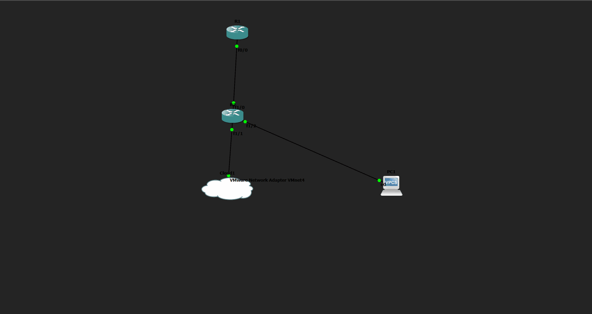

En GNS3, el equipo central puede conservar la etiqueta visual R2 aunque el hostname IOS sea `SW1`.

## 2. DHCP: concesiones del router R1
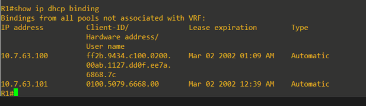

R1 ha asignado automáticamente las IP `10.7.63.100` y `10.7.63.101`.

## 3. Ubuntu como cliente DHCP
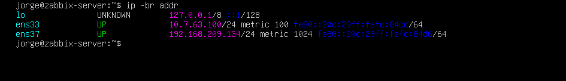

La interfaz `ens33` obtiene `10.7.63.100/24` desde Cisco. La NIC `ens37` está en una red NAT distinta.

## 4. Enrutamiento de Ubuntu
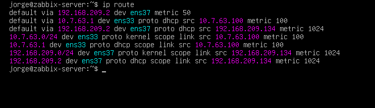

La red de laboratorio mantiene su ruta conectada y durante la instalación se dio prioridad a la ruta por VMware NAT para disponer de Internet.

## 5. Consulta SNMP desde Linux
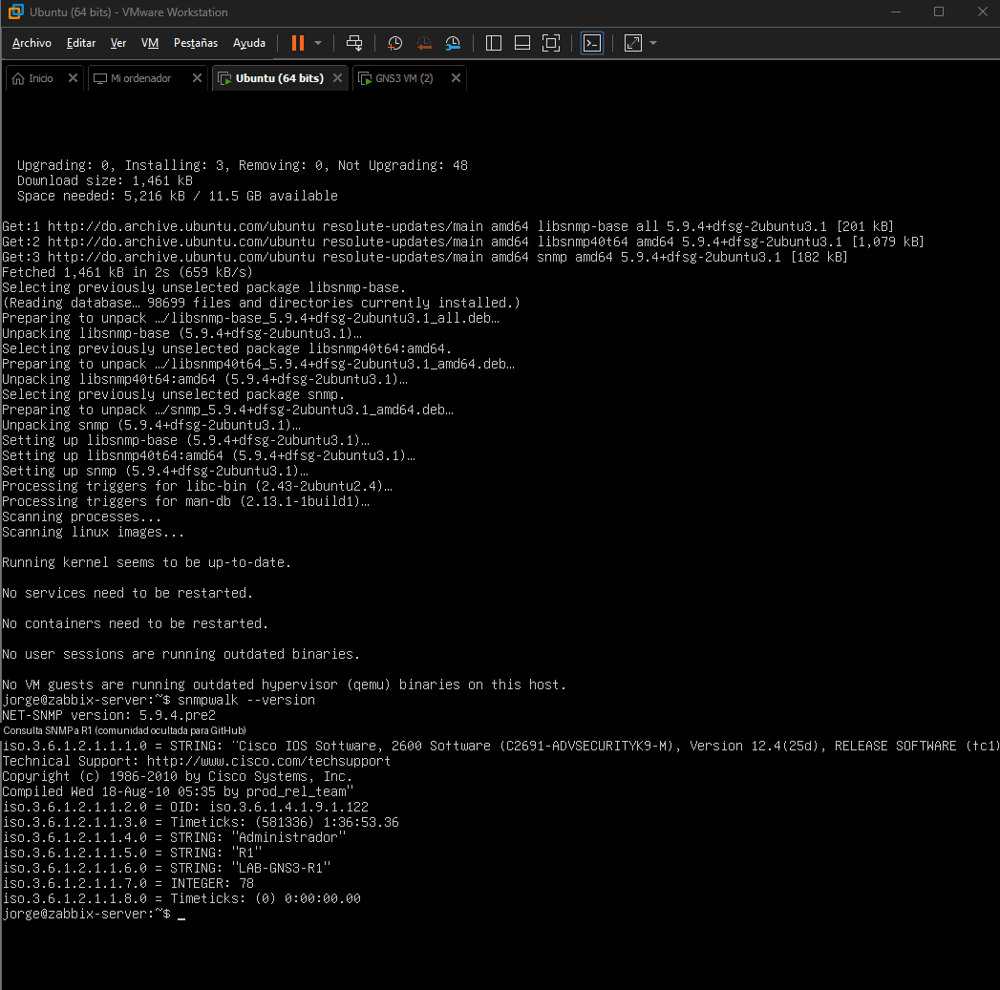
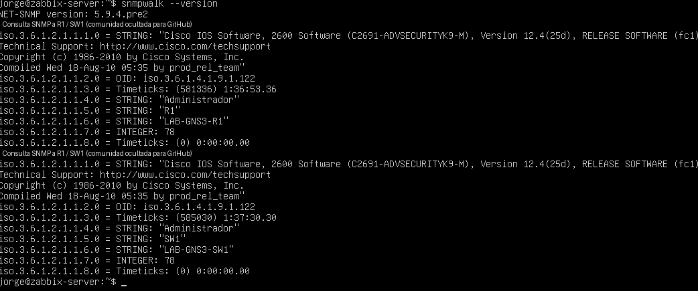

Desde Ubuntu se consultaron los OID básicos de ambas direcciones mediante SNMPv2c.

## 6. Hosts visibles y SNMP disponible en Zabbix
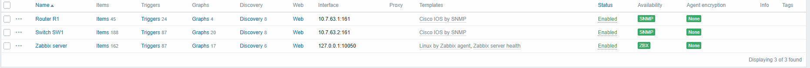

El monitor muestra ambos dispositivos habilitados, con interfaz `161/UDP`, plantilla Cisco IOS SNMP y disponibilidad verde.

## 7. Latest data: valores monitoreados
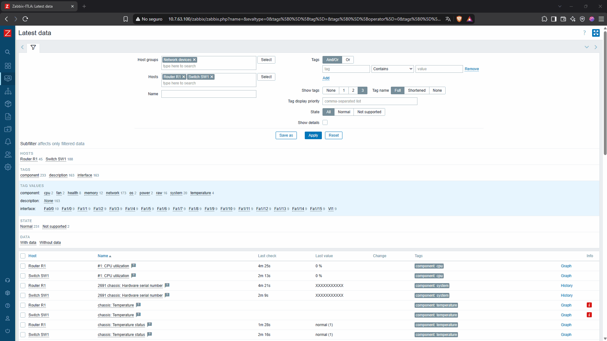
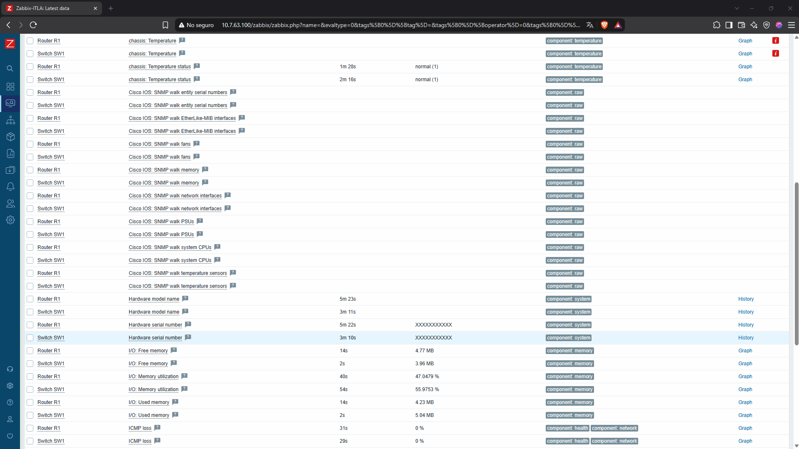
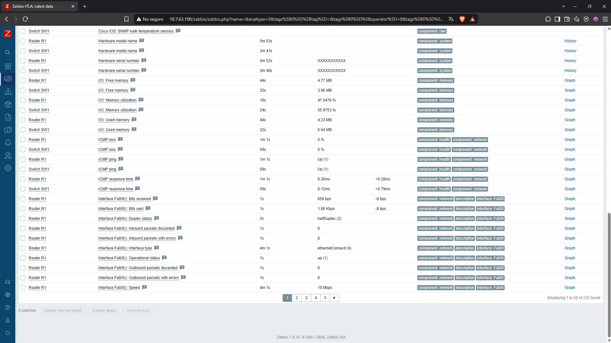

Se verificaron valores actuales de CPU, memoria, disponibilidad ICMP y estado/tráfico de interfaces.

## 8. Configuraciones completas observadas en Cisco IOS

**R1 — desde `version` hasta `end`:**

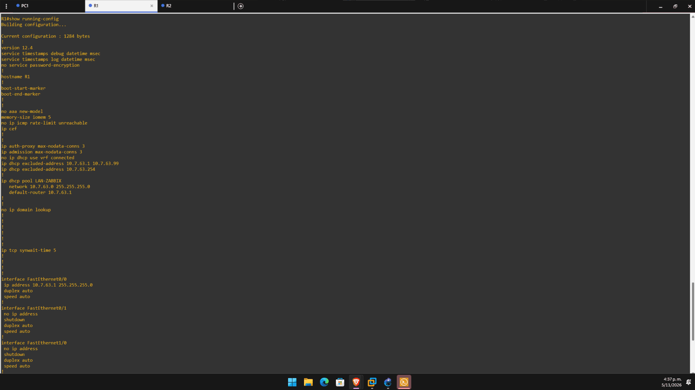
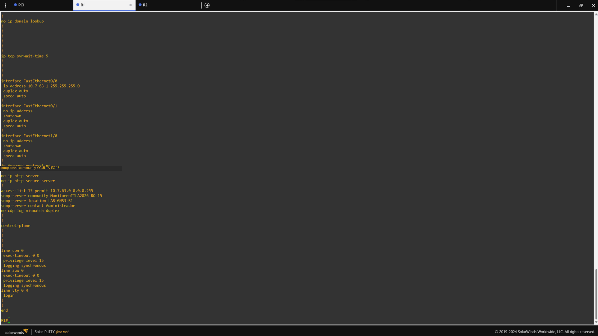

**SW1 — desde `version` hasta `end`, incluidas todas las interfaces:**

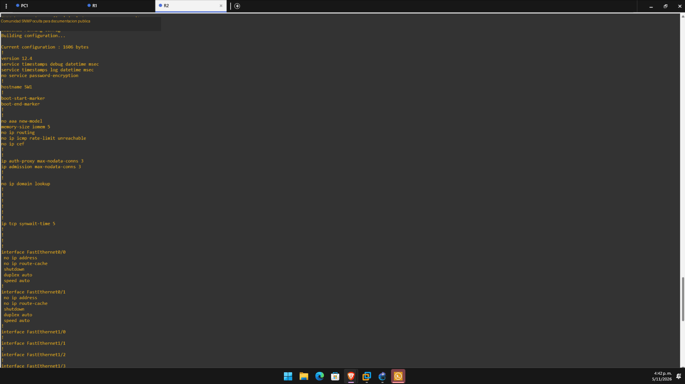
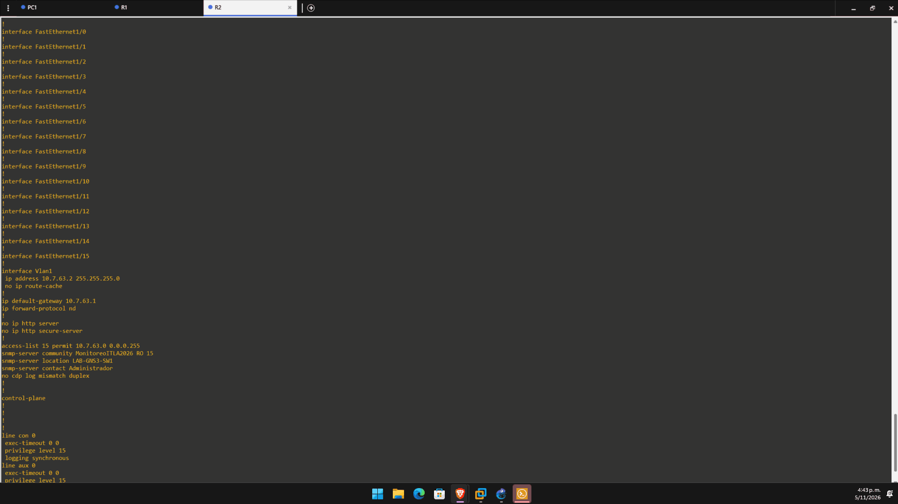
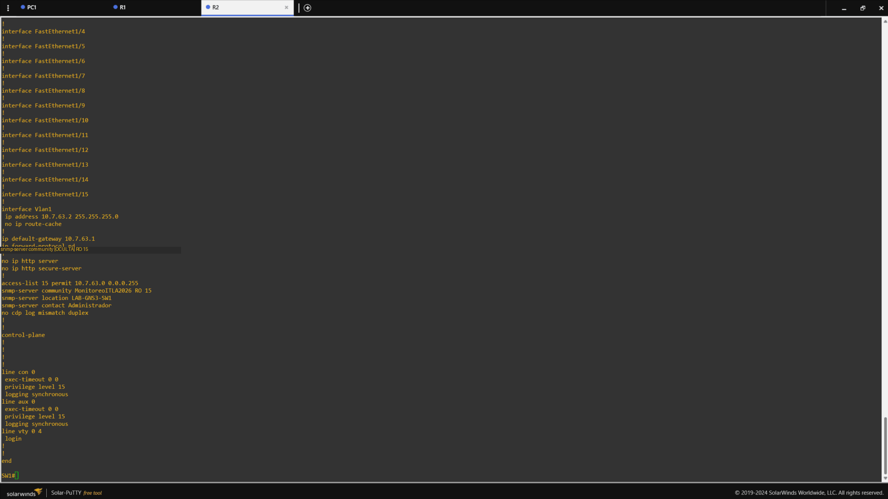

Las capturas contienen únicamente redacción visual de la comunidad SNMP. La transcripción completa y depurada está disponible en [R1](../configuraciones/R1_running-config.txt) y [SW1](../configuraciones/SW1_running-config.txt).
