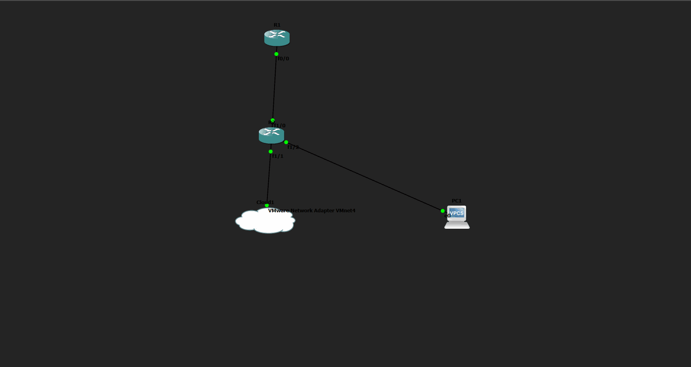
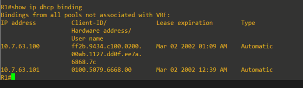
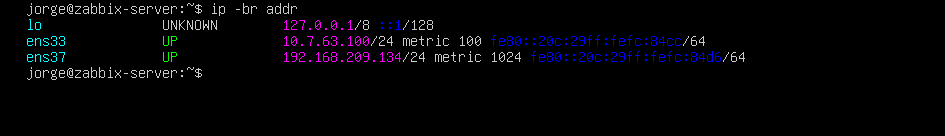
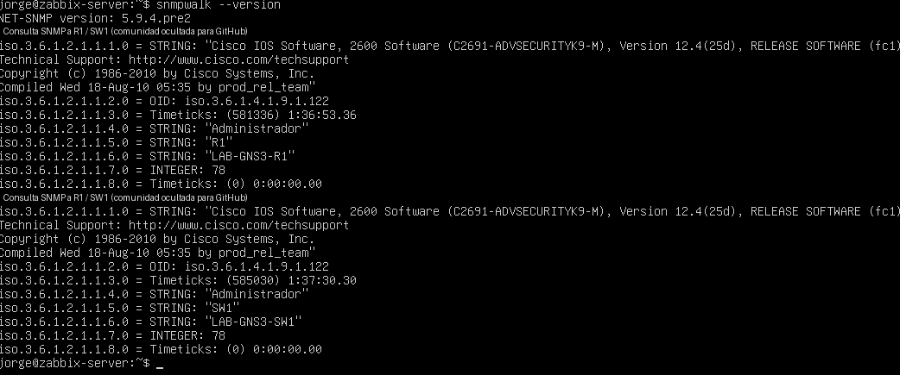
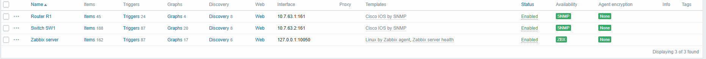
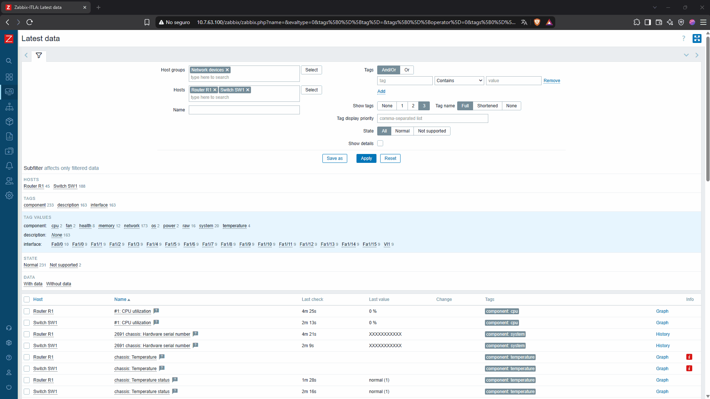
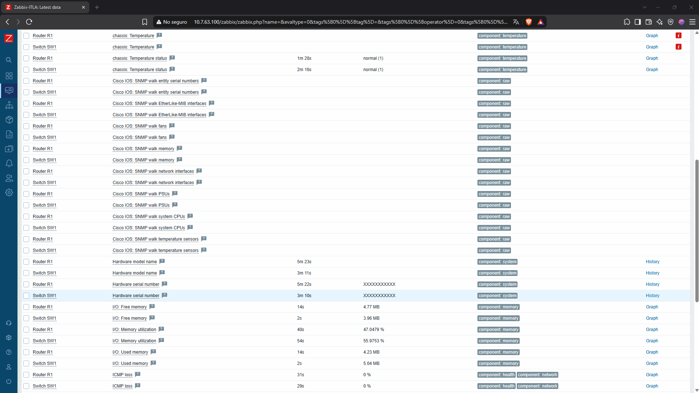
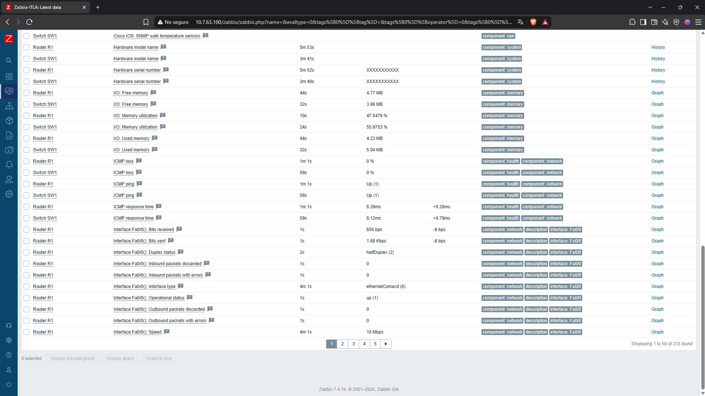

# Informe técnico — SNMP, DHCP y Zabbix

**Asignación individual:** Semana 7, Asignación 3  
**Asignatura:** Seguridad de Redes  
**Plataformas:** GNS3 con IOS Cisco 12.4, VMware Workstation, Ubuntu Server 26.04.1 LTS y Zabbix 7.4.16  
**Subred de la matrícula 20250763:** `10.7.63.0/24`

## 1. Propósito
Diseñar e implementar una LAN simulada con un servidor DHCP Cisco, gestión SNMP de solo lectura en router y switch y supervisión centralizada en Zabbix. Verificar mediante datos reales los identificadores de los dispositivos, su disponibilidad y las métricas de uso.

## 2. Descripción y arquitectura
La infraestructura consta de R1 (router Cisco c2691), SW1 (otro c2691 con módulo EtherSwitch NM-16ESW utilizado como equipo de conmutación), PC1 VPCS, Cloud GNS3 conectado a la red privada VMware VMnet4 y Ubuntu Server como servidor Zabbix y cliente DHCP.

R1 conecta `FastEthernet0/0` con `FastEthernet1/0` de SW1; PC1 a `FastEthernet1/2`; Cloud1 a `FastEthernet1/1`. El host Ubuntu utiliza `ens33` en VMnet4 para la LAN de laboratorio y `ens37` en VMnet8 NAT para acceder a Internet durante la instalación de paquetes. El nombre visual R2 de GNS3 corresponde al equipo configurado con hostname `SW1`.

[Diagrama lógico SVG](../diagramas/topologia.svg).

## 3. Direccionamiento IP
| Dispositivo | Interfaz | IP | Tipo |
| --- | --- | --- | --- |
| R1 | FastEthernet0/0 | 10.7.63.1/24 | Estática |
| SW1 | Vlan1 | 10.7.63.2/24 | Estática |
| Ubuntu Zabbix | ens33 | 10.7.63.100/24 | DHCP de Cisco |
| VPCS PC1 | eth0 | 10.7.63.101/24 | DHCP de Cisco |
| Ubuntu Zabbix | ens37 | 192.168.209.134/24 | DHCP de VMware NAT |

Las IP de Ubuntu y VPCS son observaciones de la prueba y no reservas permanentes.

## 4. Configuración DHCP
Se habilitó `LAN-ZABBIX` con red `10.7.63.0 255.255.255.0` y puerta de enlace `10.7.63.1`. Las exclusiones incluyen `10.7.63.1`–`10.7.63.99` y `10.7.63.254`, evitando asignaciones automáticas a dispositivos con IP fija.

Se verificó mediante `show ip dhcp binding`: concesiones automáticas en `10.7.63.100` y `10.7.63.101`, coincidentes con los clientes de prueba. En Ubuntu `ip -br addr` mostró `ens33 UP 10.7.63.100/24` y `ip route` confirmó la ruta de la red local.

## 5. Configuración de SNMP
Ambos Cisco tienen `snmp-server community ... RO 15`, con ACL 15 que permite `10.7.63.0/24`. Se configuraron campos de ubicación `LAB-GNS3-R1` / `LAB-GNS3-SW1` y contacto `Administrador`. En los archivos publicados se oculta exclusivamente la cadena de comunidad SNMP.

Los ensayos `snmpwalk -v2c` desde Ubuntu respondieron correctamente para las IP `10.7.63.1` y `10.7.63.2`; devolvieron OID de descripción del sistema, uptime, nombre y ubicación.

## 6. Servidor Zabbix
Se instaló Zabbix 7.4.16 (servidor, frontend, Apache y agente) y MariaDB como almacenamiento. Se creó una base de datos `zabbix` y se importó el esquema inicial con **207 tablas** registradas durante la comprobación. Los servicios `zabbix-server`, `mariadb` y `apache2` se comprobaron activos.

En el asistente web se configuró el nombre `Zabbix-ITLA`. Se crearon dos hosts habilitados en el grupo `Network devices`, cada uno con interfaz SNMPv2/UDP 161 y plantilla `Cisco IOS by SNMP`:
- **Router R1** → `10.7.63.1:161`
- **Switch SW1** → `10.7.63.2:161`

La vista `Data collection → Hosts` confirmó disponibilidad **SNMP** (verde) en ambos.

## 7. Resultados observados
En `Monitoring → Latest data`, la captura mostró **233 elementos** encontrados: **231 normales** y **2 no soportados**. Se observaron valores de CPU, memoria, estado ICMP e interfaces. Por ejemplo, CPU de 0 % en ambos dispositivos y uso de memoria aproximado de 47,05 % en R1 y 55,98 % en SW1. Estas métricas son medidas del momento de la captura y pueden cambiar.

Los dos ítems no soportados provienen de la plantilla y las capacidades expuestas por el equipo virtual; no significan que los hosts SNMP estén inactivos.

## 8. Incidencias y resolución
- Se creó VMnet4 como red Host-only para impedir que el DHCP de VMware compitiera con el DHCP del router. Se verificó conectividad IP en el segmento.
- Se corrigió un conflicto de IP con el adaptador VMnet4 del host Windows, utilizando una dirección distinta de R1.
- Ubuntu conservó `ens33` en DHCP de Cisco y una segunda NIC `ens37` por NAT de VMware. Se añadió temporalmente una ruta por defecto de menor métrica vía NAT para disponer de Internet durante la instalación.
- Se ajustó la URL del repositorio oficial de Zabbix para Ubuntu 26.04 y se instalaron sus paquetes.
- Se habilitaron los módulos `proxy`, `proxy_fcgi` y `setenvif` de Apache cuando `apache2ctl configtest` reportó que `ProxyTimeout` no estaba reconocido.
- Se verificó la conexión entre Zabbix y MariaDB y se completó el asistente de inicialización web.

### Configuraciones completas documentadas

Se publican [la transcripción completa de R1](../configuraciones/R1_running-config.txt) y [la de SW1](../configuraciones/SW1_running-config.txt), acompañadas de [capturas del inicio y final de ambos `show running-config`](evidencias.md#8-configuraciones-completas-observadas-en-cisco-ios).

## 9. Seguridad y observaciones
- SNMPv2c usa cadena de comunidad sin cifrado; se mantiene **solo en el entorno aislado de laboratorio**. Su permiso es de lectura (`RO`), filtrado por una ACL que abarca toda la red `10.7.63.0/24`.
- No se publican contraseñas de MariaDB, Zabbix o la comunidad SNMP.
- Los running-config publicados son transcripciones completas de las líneas visibles en `show running-config`, con sustitución de credencial. Un archivo exportado directamente desde la consola es la evidencia más fuerte si se dispone de él.
- La ruta de Internet con `ip route replace` fue temporal en la prueba: para conservarla tras reinicio debe configurarse mediante Netplan, sin alterar DHCP de `ens33`.
- Para reproducir resultados conviene conservar las mismas interfaces virtuales y la red Host-only.

## 10. Conclusiones
Se comprobó que R1 entrega direcciones DHCP a Ubuntu y VPCS; que ambos Cisco responden a consultas SNMP de solo lectura; y que Zabbix obtiene métricas reales, disponibilidad e información de sus interfaces. La infraestructura satisface los objetivos técnicos indicados para el monitoreo de la LAN.

Para las capturas originales, consulta [Evidencias](evidencias.md); para comandos, consulta [Procedimiento](procedimiento.md); para configuraciones, consulta [R1](../configuraciones/R1_running-config.txt) y [SW1](../configuraciones/SW1_running-config.txt).
